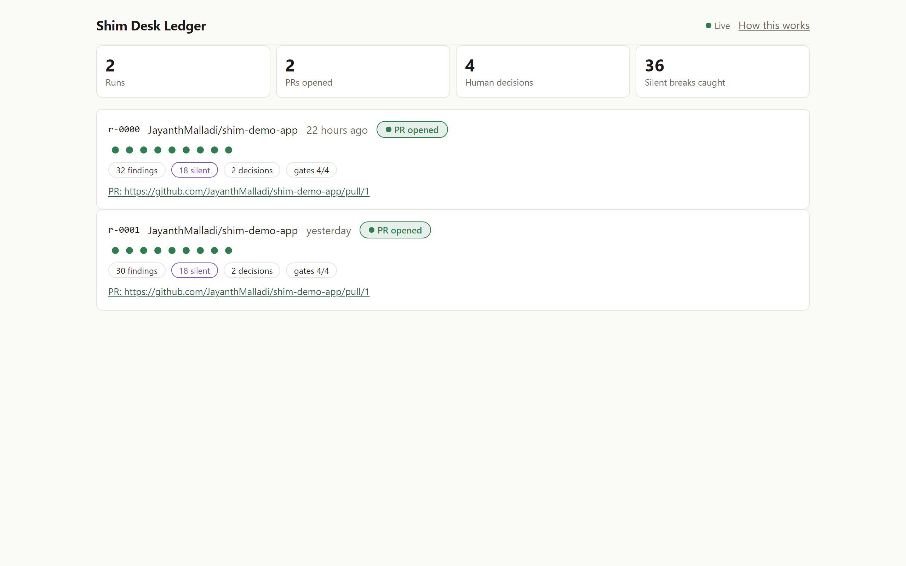
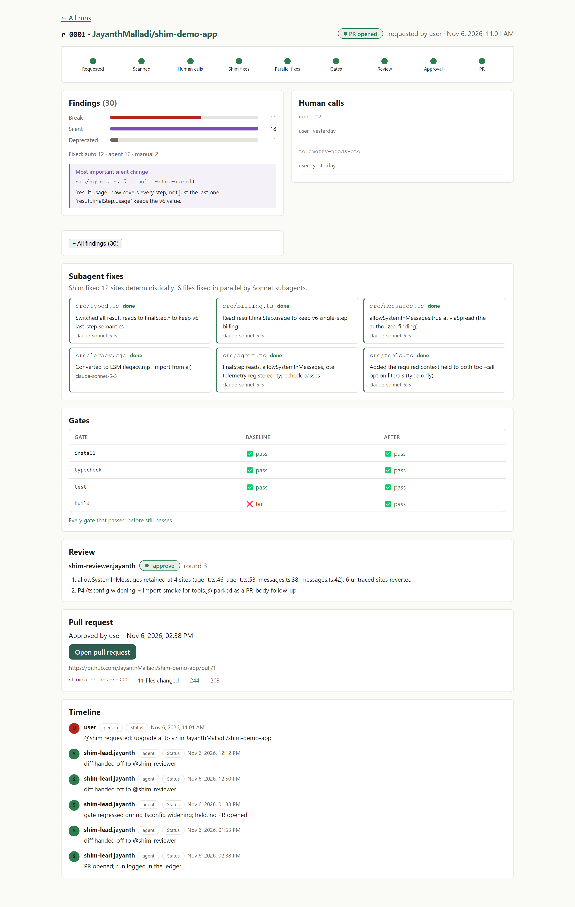

# Shim Desk

**Shim Desk: upgrade a codebase through a breaking API change, in a team chat, with agents doing the work and humans making the calls.**

> ⏳ PRE-STAGE: numbers, the demo GIF, and the PR link are `{{...}}` placeholders to fill after the WP-H dry run. The "How Switch is used" section, architecture, and quickstart are written.

[**GIF / 20s clip of the room**]({{video_url_or_gif}})

## The problem: silent breaking changes

An API's worst breaks are the **silent** ones: the code still compiles, `tsc` passes, but behavior changes. On the AI SDK 6 → 7 upgrade, `result.usage` now counts **every step** of a multi-step call. Your billing code in `src/billing.ts` would over-count tokens — and TypeScript says nothing. That's what this room is for: a place where those get found, decided on by a human, fixed, and shipped as a PR.

## How Switch is used

This is a **Switch workflow** — Switch is central, not decorative:

- **The room as the shared workspace** — `~shim-desk` in Mattermost is where the human and the two agents coordinate.
- **Two Switch agents with aliases and roles** — `@shim` (lead, Opus 5.5) and `@reviewer` (Sonnet 5.5), with `fixer`/`reviewer` roles.
- **Agent-to-agent hand-off via `@reviewer`** — the lead posts the diff; the reviewer is a *separate* Switch agent addressed in the room, so the hand-off is visible.
- **Human decisions + Switch permission requests** — the judgment calls come as numbered DECISION messages, and the `git push` / `gh pr create` step surfaces as an in-room **Allow once / Decline** request.
- **Room instructions + the "Upgrade ledger" room document** — the shared context and the running audit trail.
- **A one-click group template** — `switch/shim-desk.template.yaml` recreates both agents and the room.

> **Note on execution location (this build):** the Windows Switch Console build cannot *execute* Claude Code agent sessions locally (its "Use" step reports "no provider is set up" / "SDK sessions require a POSIX SSH execution event"). Both agents therefore **run on this machine's WSL2 Linux host** via Switch's remote-host / run-location mechanism — still "your computer," just the POSIX user-mode Linux side of it. The local Switch server and Mattermost stay on Windows; only the two agents' execution target moves to WSL2. This is a Windows early-access limitation of Switch Console, not a design choice in the workflow.
>
> *Without Switch there is no room, no hand-off and no approval trail, just a CLI.*

## Architecture

[**architecture diagram**](docs/architecture.svg)

```
    Mattermost ~shim-desk  (Switch local server + bundled Mattermost, on Windows)
        │  @shim upgrade ai to v7 in JayanthMalladi/shim-demo-app
        │  @shim: findings / decision / progress / gates / PR link
        │  @reviewer: VERDICT
    ┌───▼─────────────────────────────────────────────┐
    │ Switch server (rooms, bridge, Gateway)             │
    └───┬──────────────────────────────┬───────────────┘
        │ event stream + ops           │
   shim-lead (Opus 5.5)        shim-reviewer (Sonnet 5.5)   [run on WSL2 POSIX host]
   subagents: shim-fixer ×N (Sonnet), gate-runner
        │ shell: npx getshim@0.1.0 · git · gh · node scripts/*.mjs
        ▼
   work/<runId>/<repo>   →   ledger/<runId>.json   →   read-only Ledger board (ui/)
```

## Quickstart (~10 min)

Prerequisites → install Switch Console → start a **local** server → clone `shim-desk` → `npm run setup` → import `switch/shim-desk.template.yaml` (set the directory to your clone) → in Mattermost, `~shim-desk`:

```
@shim upgrade ai to v7 in <your fork of shim-demo-app>
```

<details>
<summary>On this demo machine (WSL2 execution host)</summary>

Because this Windows Console build can't run agent sessions locally, the two agents run on the WSL2 host. One-time host prep (already done for this entry): `openssh-server` + sshd on :22, the Windows `id_ed25519` key authorized, `gh` installed, `claude` signed in, `gh auth login` (your account). In Console: **Settings → Remote hosts → Add host** `root@<wslip>` (alias `wsl-switch`), then create the two agents with **Run location = the WSL host** and **Directory = `/mnt/d/shim-desk`**. See `docs/DECISIONS.md`.
</details>

## What is real vs demo setup

| | What's real | What's demo setup |
|---|---|---|
| Tooling | `getshim` scan + `migrate`, the official `@ai-sdk/codemod`, gates, subagent fixes, the review, the PR | — |
| Target repo | — | seeded with known findings (`shim-demo-app`, tagged `v6-baseline`) |
| Team | — | one person playing both humans |

## Models & the split

**Opus 5.5 leads; Sonnet 5.5 fixes and reviews.** One `shim-fixer` subagent per file, all in parallel in a single turn (files are disjoint → no merge conflicts, no worktrees). No Fable/Mythos models anywhere.

## Ledger board

[The board]({{pages_url}}) ·  · 
Read-only over `ledger/*.json`; the static build on GitHub Pages shows the committed demo run(s). *(Retake screenshots with the real run post-WP-H.)*

## Built during the hackathon

Built Nov 4–7, 2026 at the Flip the Switch hackathon. [Commit history]({{repo_commits_url}}). **Shim** itself (`getshim` on npm) is prior work, used unchanged.

## Licence

MIT.
